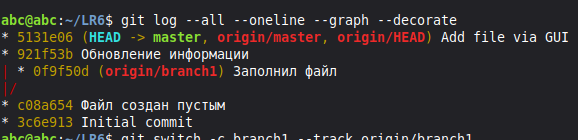
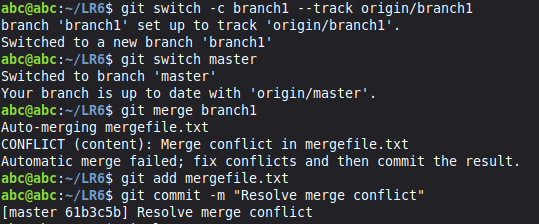
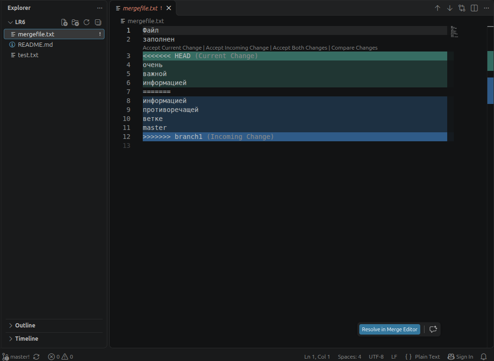
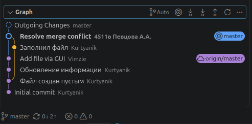
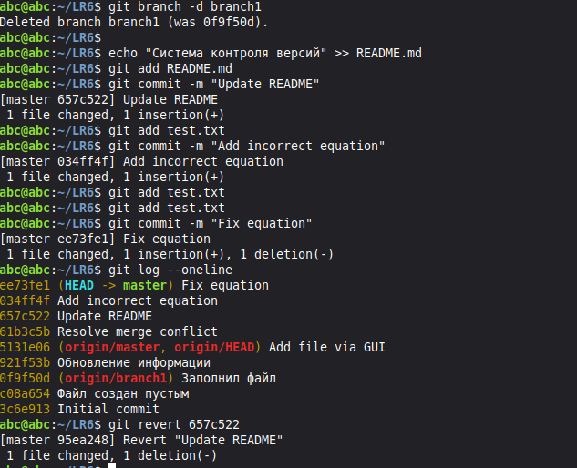

# Лабораторная работа №6  

Система контроля версий

## Цель работы
Изучение базовых возможностей системы управления версиями, опыт работы с Git Api, опыт работы с локальным и удаленным репозиторием.

## Ход выполнения работы

### Работа с ветками
* Получена история операций для каждой из веток.



* Выполнено слияние в ветку master, разрешён конфликт.







* Удалена побочная ветка после успешного слияния.

### Создание коммитов
* Сделаны и зафиксированы изменения, оставлены комментарии.

* Сделан откат коммита.



### Лог команд
```bash
git clone https://github.com/Vimzle/LR6.git
cd LR6
git branch -a
git config user.name "4511в Певцова А.А."
git config user.email "NOREPLY_EMAIL"
git status
git pull
git log --all --oneline --graph --decorate
git switch -c branch1 --track origin/branch1
git switch master
git merge branch1
git add mergefile.txt
git commit -m "Resolve merge conflict"
git log
git branch -d branch1
echo "Система контроля версий" >> README.md
git add README.md
git commit -m "Update README"
git add test.txt
git commit -m "Add incorrect equation"
git add test.txt
git commit -m "Fix equation"
git log --oneline
git revert 657c522
```
